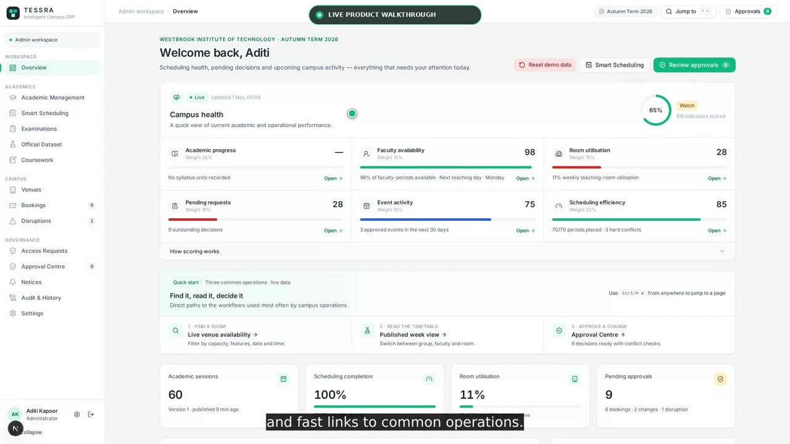
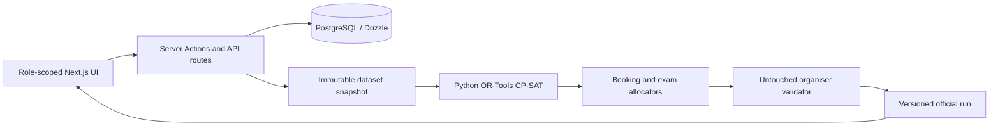

# TESSRA — Technical Approach

TESSRA is implemented as a **constraint-first campus operations platform** rather than a calendar UI with conflict warnings added afterward. The system treats timetable generation, venue bookings, examinations, and disruption repair as one governed scheduling problem with explicit validity rules, deterministic optimization, independent verification, role-scoped workflows, and an auditable publication boundary.

## Reference links

- **Live application:** [tessra-five.vercel.app](https://tessra-five.vercel.app)
- **Live CIT workbench:** [Admin → Official Dataset](https://tessra-five.vercel.app/admin/official)
- **CIT problem statement:** [`official/problem-statement.txt`](./official/problem-statement.txt)
- **Official CIT dataset:** [`cit_public.json`](./official/starterpack/CrunchWeek_StarterPack/data/cit_public.json)
- **Organiser starter pack and validator:** [`official/starterpack/CrunchWeek_StarterPack`](./official/starterpack/CrunchWeek_StarterPack)
- **Constraint evidence:** [`docs/CONSTRAINT_VERIFICATION.md`](./docs/CONSTRAINT_VERIFICATION.md)

## Product walkthrough

[](https://raw.githubusercontent.com/kunalchwdry/TESSRA/main/docs/media/TESSRA_Live_Product_Walkthrough.mp4)

**[▶ Watch the 4:42 live product walkthrough](https://raw.githubusercontent.com/kunalchwdry/TESSRA/main/docs/media/TESSRA_Live_Product_Walkthrough.mp4)** · [Download MP4](./docs/media/TESSRA_Live_Product_Walkthrough.mp4) · [Captions](./docs/media/TESSRA_Live_Walkthrough_Captions.srt) · [Transcript](./docs/media/TESSRA_Live_Walkthrough_Transcript.txt)

---

## 1. System decomposition

The implementation is split into three trust domains:

1. **Product layer — Next.js and TypeScript**
   - Four role workspaces: Admin, Coordinator, Faculty, and Club Representative.
   - Server Components for reads and Server Actions/Route Handlers for mutations.
   - Server-side role guards on every protected route and action.
   - PostgreSQL persistence through Drizzle ORM for operational data, audit history, immutable official runs, and approval state.

2. **Optimization layer — Python and OR-Tools CP-SAT**
   - Builds legal assignment domains from the selected organiser dataset.
   - Enforces H1–H14 as hard constraints or domain exclusions.
   - Minimizes the exact weighted S1–S6 objective.
   - Deterministically allocates bookings and examinations.
   - Performs two-phase, minimum-move disruption repair.

3. **Verification layer — organiser validator**
   - The supplied `validator.py` is retained unmodified and treated as the final authority.
   - The validator receives the same dataset snapshot and generated export as the solver pipeline.
   - Its report is persisted verbatim and displayed in the product; invalid output is surfaced rather than hidden.



## 2. Dataset ingestion and provenance

The official pipeline begins by parsing organiser-format JSON and rejecting malformed input before invoking the solver. Validation covers:

- schema and field types;
- unique identifiers;
- room, course, faculty, group, session, booking, and exam references;
- calendar periods, lunch, lab starts, and event-only windows;
- role/category declarations and booking policy;
- unavailability blocks, cancellations, and fixed placements;
- disruption references and all supported change operations.

A successful upload is stored as an immutable snapshot containing the parsed dataset, source filename, dataset identifier, SHA-256 digest, loader, and load time. Generation, validation, export, and later disruption repair all resolve the same snapshot, preventing input drift between solver and validator runs.

## 3. CP-SAT assignment model

For every teaching session `s`, the engine constructs a legal candidate set:

```text
A(s) = {(day, start_period, room) | timing, room, capacity,
        availability, accessibility and fixed-slot rules all hold}
```

A Boolean decision variable `x[s,d,p,r]` is created only for members of `A(s)`. Invalid combinations therefore do not exist in the search space and cannot be exchanged for a lower soft penalty.

The principal constraints are:

- **H1 — assignment completeness:** `Σ x[s,d,p,r] = 1` for every required session.
- **H2 — faculty exclusivity:** at most one covering assignment for each faculty/day/period.
- **H3 — group exclusivity:** at most one covering assignment for each student group/day/period; elective baskets contribute one synchronized occupancy.
- **H4 — room exclusivity:** at most one class, approved event, or examination occupies a room-period.
- **H5/H6 — room feasibility:** candidate rooms satisfy capacity, type, and allowed-use requirements; examination capacity is `floor(capacity / 2)`.
- **H7/H8 — availability:** candidates intersecting faculty or room unavailability are removed.
- **H9 — calendar legality:** teaching is limited to P1–P9, sessions cannot cross lunch, and three-hour laboratories start only at P2 or P6.
- **H10 — accessibility:** accessibility-required sessions use accessible rooms only.
- **H11 — basket synchronization:** every member of an elective basket is linked to one shared day/start variable while retaining independent room assignment.
- **H12 — daily load:** the duration-weighted faculty assignment sum cannot exceed `max_hours_per_day`.
- **H13 — governed bookings:** approved bookings are processed in official priority order against class, room, booking, and mandatory-group occupancy.
- **H14 — fixed placement:** non-fixed day/start/room combinations are absent from a fixed session's domain.

An independent `check_assignment` implementation re-evaluates generated placements separately from the model before the organiser validator is executed.

## 4. Exact S1–S6 objective

Soft optimization begins only after the hard model is satisfiable. The objective is the organiser-defined weighted sum:

```text
minimize
    2 × faculty_avoidance_periods          (S1)
  + 1 × internal_group_gaps                (S2)
  + 3 × group_hours_above_six              (S3)
  + 3 × repeated_course_lectures           (S4)
  + 1 × rooms_below_40_percent_utilisation (S5)
  + 1 × sessions_occupying_P9              (S6)
```

S2 is represented through occupied-before, occupied-after, and unoccupied-at-period Boolean relationships. S3 and S4 use non-negative excess variables. S1, S5, and S6 are assignment-local costs. The objective therefore remains explainable and is reproduced independently by the validator.

## 5. Booking and examination allocation

Bookings and examinations share occupancy state with teaching instead of being generated in isolated calendars.

### Booking pipeline

- Normalizes cancellations and computes the effective category allowed by the requester's role cap.
- Sorts competing requests by official category rank and submission order.
- Checks room fit, time windows, mandatory groups, timetable occupancy, examination occupancy, and previously accepted bookings.
- Produces one of three explicit outcomes: approved, compatible alternative, or rejected.
- Re-runs deterministic validation when an Admin or Coordinator makes the final decision.

Natural-language booking input is deliberately an untrusted convenience layer. English/Hinglish text produces an editable draft; it cannot modify server-owned priority, role, approval, or conflict fields.

### Examination pipeline

- Uses the organiser's AM/PM examination windows.
- Applies half-capacity to every candidate room.
- Supports multi-room allocations for large cohorts.
- Prevents room and group collisions and evaluates the organiser's examination penalty independently.

## 6. Lexicographic disruption repair

Repair quality is not represented by an arbitrary weighted mixture of stability and timetable quality. TESSRA solves two ordered CP-SAT problems.

Let `M` be the number of baseline sessions whose day, start period, or room changes.

1. **Phase 1 — stability proof**
   - Minimize `M` subject to H1–H14 and the supplied disruption.
   - Require CP-SAT `OPTIMAL` status.
   - Persist the optimum `M*` and `minimum_moves_proven = true`.

2. **Phase 2 — quality at the proven minimum**
   - Add the equality constraint `M = M*`.
   - Minimize the exact S1–S6 expression.

This proves that no hard-valid repair can move fewer than `M*` baseline sessions. The UI displays an exact before/after/added/removed diff, and `schedule_after.json` remains unavailable until a separate Admin approval action.

## 7. Product integration and governance

The optimization pipeline is exposed through normal operational workflows rather than evaluator-only controls:

- Admins generate and inspect timetables, search live venue availability, review bookings, manage exams, and approve disruption plans.
- Faculty see their own schedule, maintain availability, request validated changes, and inspect deterministic scheduling explanations.
- Coordinators operate within department scope and review department-owned laboratory requests.
- Clubs submit policy-capped venue requests and receive tracked decisions.
- Targeted notices create private recipient deliveries with acknowledgement tracking.
- Campus Health is a deterministic read-only projection over six operational indicators; it does not send institutional data to an LLM or analytics service.

Every protected mutation starts with a server-side role check. The database records approvals, notifications, dataset identity, official reports, and audit events; browser state is never treated as authorization.

## 8. Verification strategy

Verification occurs at several independent levels:

1. Schema and reference validation before solving.
2. CP-SAT model constraints and solver status.
3. Independent assignment checking after solving.
4. Untouched organiser `validator.py` execution.
5. Python unit tests for the engine and TypeScript tests for product policies.
6. Versioned exports and SHA-256 fingerprints for reproducibility.

The checked-in evidence reports:

```text
Baseline
  189 / 189 sessions placed (243 teaching hours)
  41 / 41 examinations allocated
  0 hard violations
  S1=0, S2=0, S3=0, S4=3, S5=0, S6=0 → soft total 3
  booking score 65.5 / 70
  21 approved, 2 alternatives, 2 rejected, 0 priority inversions

Supplied disruption
  190 / 190 sessions placed
  0 hard violations, soft total 3
  minimum proven: 8 moved sessions
  2 time changes + 6 room-only changes
```

The implementation is consequently designed around a strict invariant: **the UI may propose and explain decisions, but only server-side deterministic logic and the independent validator can declare them valid.**
